# Automation: IaC Toolchain

## Infrastructure as Code Mapping

This high-level topology defines the strict operational boundaries between infrastructure provisioning and configuration management within the homelab. 

{ loading=lazy }
{ loading=lazy }
*Fig 1: High-level mapping of automation tools to infrastructure components.*

*   **Terraform (Provisioning):** Responsible for immutable infrastructure. It orchestrates the creation of Proxmox VMs (allocating compute, storage, and network bridges) and handles the Kubernetes OS bootstrapping (Talos Linux) across both virtual worker nodes and bare-metal control planes.
*   **Ansible (Configuration):** Responsible for stateful OS and service management. It configures the OpenWrt Layer 3 routing (DSA), sets up the Proxmox hypervisor baseline, and manages the guest OS configuration for standalone, non-K8s VMs (e.g. Kali Linux, Home Assistant).
*   **Hardware Exception:** The Netgear L2 switch lacks API manageability. As formally accepted in **[ADR-002](https://linusb.github.io/homelab/ADR/002/API-Limitation-on-L2/#adr-002-layer-2-automation-strategy-for-api-limited-network-hardware)**, it requires a manual, one-time "Day-Zero" setup to configure the static trunk and access ports.

---

## Execution Pipeline

The following state diagram outlines the sequential execution phases required to bootstrap the environment from bare metal to a fully operational state.

```mermaid
stateDiagram-v2
    direction TB
    [*] --> Phase1_Network

    state "Phase 1: Network (Layer 2 & Layer 3)" as Phase1_Network {
        state fork_network <<fork>>
        [*] --> fork_network
        
        fork_network --> OpenWrt_Config_Ansible : Automated via SSH/API
        fork_network --> Netgear_Config_Manual : Manual Out-of-Band Setup
        
        state join_network <<join>>
        OpenWrt_Config_Ansible --> join_network
        Netgear_Config_Manual --> join_network
        join_network --> [*]
    }

    Phase1_Network --> Phase2_Proxmox

    state "Phase 2: Proxmox Baseline (Ansible)" as Phase2_Proxmox {
        [*] --> Host_Config : Updates, <br>NTP, <br>'VLAN-aware' Bridge, <br>ZFS Mirror
        Host_Config --> [*]
    }

    Phase2_Proxmox --> Phase3_VMs

    state "Phase 3: Virtual Machines (Terraform)" as Phase3_VMs {
        [*] --> Provision_VMs : CPU, RAM, Disks
        Provision_VMs --> Network_Assignment : Attach to VLAN Bridges
        Network_Assignment --> [*]
    }

    Phase3_VMs --> Phase4_Talos

    state "Phase 4: Kubernetes OS (Terraform)" as Phase4_Talos {
        [*] --> Generate_Talos_Config : YAML generation
        Generate_Talos_Config --> Bootstrap_Nodes : API deployment
        Bootstrap_Nodes --> Await_Quorum : [Buffer] Wait for etcd consensus
        Await_Quorum --> Fetch_Kubeconfig : Download to Admin
        Fetch_Kubeconfig --> [*]
    }

    Phase4_Talos --> Phase5_Workloads

    state "Phase 5: Guest OS & Workloads" as Phase5_Workloads {
        state fork_workloads <<fork>>
        [*] --> fork_workloads
        
        fork_workloads --> Non_K8s_VMs_Ansible
        fork_workloads --> K8s_Workloads_Helm
        
        state "Standard VMs (Ansible)" as Non_K8s_VMs_Ansible {
            [*] --> Wait_For_SSH : [Buffer] Wait for VM boot
            Wait_For_SSH --> Config_Kali_VM : Install Security Tools
            Wait_For_SSH --> Config_HomeAssistant_VM : Setup IoT
            Config_Kali_VM --> [*]
            Config_HomeAssistant_VM --> [*]
        }
        
        state "Kubernetes (Terraform/Helm)" as K8s_Workloads_Helm {
            [*] --> Wait_For_API : [Buffer] Wait for K8s Readiness
            Wait_For_API --> Deploy_Longhorn : Stateful Storage
            Deploy_Longhorn --> Deploy_Ingress : Traefik / Apps
            Deploy_Ingress --> [*]
        }
        
        state join_workloads <<join>>
        Non_K8s_VMs_Ansible --> join_workloads
        K8s_Workloads_Helm --> join_workloads
        join_workloads --> [*]
    }

    Phase5_Workloads --> [*]
```

